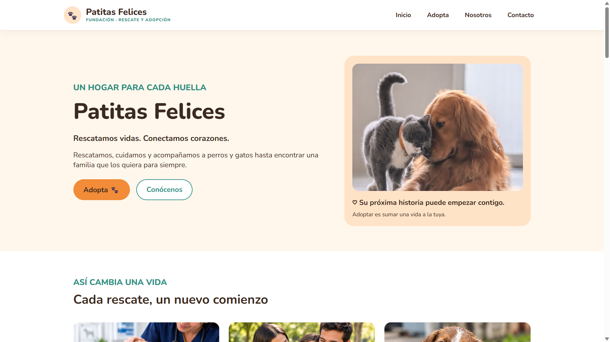
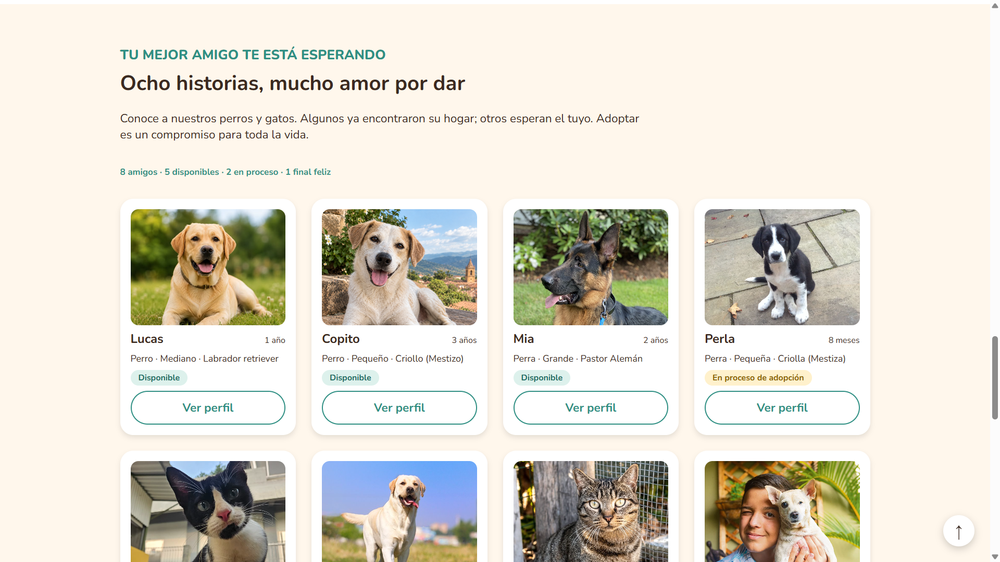
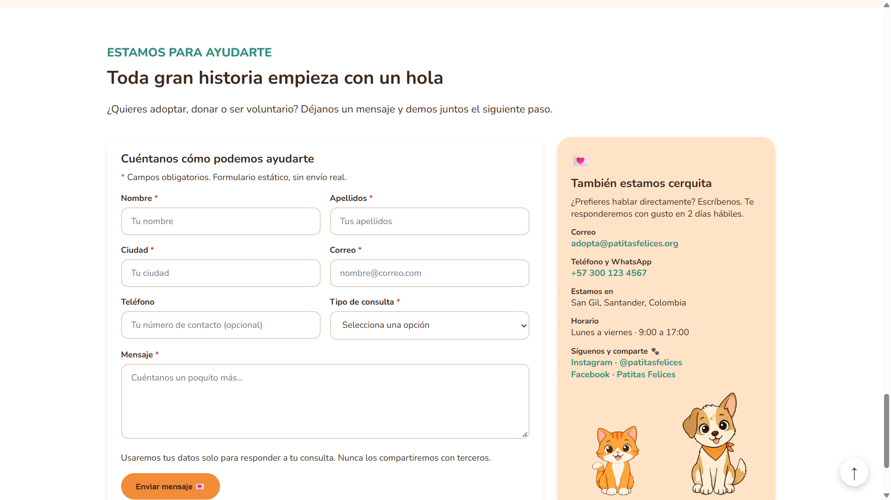
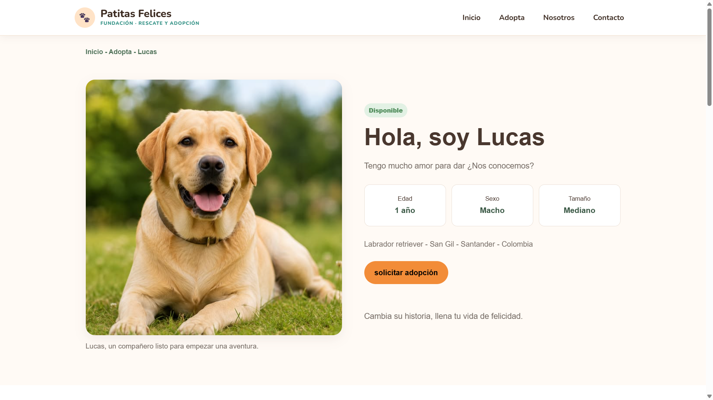
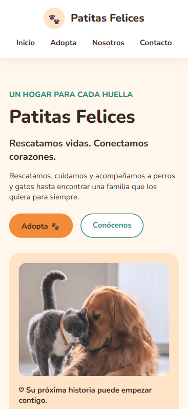

# 🐾 Patitas Felices

Maqueta web estática para la **Fundación Patitas Felices**, una organización dedicada al rescate, cuidado y reubicación de perros y gatos en situación de abandono. El sitio da a conocer su trabajo, su misión y visión, los animales que buscan hogar y las formas de contactar y apoyar a la fundación.

Está construida con **HTML y CSS nativos, sin JavaScript**: los componentes interactivos (carrusel, animaciones, validación de formulario, botón flotante) se simulan solo con CSS.

**Demo en vivo:** https://fundacionpatitasfelices.vercel.app/#inicio

---

## Objetivo

Transmitir la identidad de la fundación y facilitar que quien la visita pueda, en pocos clics:

- entender qué hace la fundación y cómo ayudar,
- conocer los animales disponibles para adopción,
- contactar a la organización.

La maqueta es visualmente atractiva, accesible y responsive (escritorio, tableta y celular).

## Vistas y secciones

| Vista | Secciones |
| --- | --- |
| **Inicio** (`index.html`) | Banner principal con nombre, eslogan y botones "Adopta" y "Conócenos" · Carrusel "Así cambia una vida" (rescate, cuidado, adopción) · Formas de ayudar (Adopta, Donaciones, Voluntariado, Contacto) · Testimonios · Misión y Visión · Galería en mosaico · Catálogo de 8 animales · Formulario y datos de contacto · Footer |
| **Perfil de animal** (`perfil.html`) | Foto grande, características (edad, sexo, tamaño), historia, salud y comportamiento, botón "Solicitar adopción" (no funcional) y carrusel horizontal de animales relacionados |

## Cómo se simulan los componentes interactivos con CSS

| Componente | Técnica |
| --- | --- |
| Carrusel automático (cambia cada 3 s) | `@keyframes` + `transform: translateX()` sobre una pista de tarjetas con `overflow: hidden`; se pausa con `:hover` y respeta `prefers-reduced-motion` |
| Validación visual del formulario | `required`, `type="email"` y las pseudoclases `:placeholder-shown`, `:valid` e `:invalid` |
| Mascotas animadas | Sprites con `background-position` y `steps()` |
| Navegación suave entre secciones | `scroll-behavior: smooth` y `scroll-padding-top` |
| Botón flotante "subir" | `position: fixed` y `animation-timeline: scroll()` |
| Efectos al pasar el mouse | `:hover`, `transition` y `transform` en tarjetas, botones y galería |

## Diseño responsive

El diseño parte de escritorio y se adapta con media queries:

| Rango | Ancho | Cambios principales |
| --- | --- | --- |
| Escritorio | más de 1000 px | Hero a dos columnas, rejillas de 4 columnas, carrusel de 3 tarjetas |
| Tableta | hasta 1000 px | Rejillas de 2 columnas, carrusel de 2 tarjetas, formulario y tarjeta de contacto apilados |
| Celular | hasta 700 px | Una sola columna, carrusel de 1 tarjeta, header apilado |

## Accesibilidad

- HTML semántico (`header`, `nav`, `main`, `section`, `article`, `aside`, `figure`, `footer`).
- Texto alternativo (`alt`) en cada imagen y `aria-label` en los elementos decorativos con significado (mascotas, botón de subir).
- Etiquetas `label` asociadas a cada campo del formulario con `for` e `id`.
- Foco visible en los campos y contraste de color entre texto y fondo.
- Animaciones desactivadas para quien activa "reducir movimiento" en su sistema.

## Estructura del proyecto

```text
patitas-felices/
├── index.html          # Página de inicio
├── perfil.html         # Perfil de un animal
├── css/
│   └── styles.css      # Estilos (variables, componentes y media queries)
├── img/                # Fotografías y sprites
├── docs/
│   └── capturas/       # Capturas usadas en este README
└── README.md
```

No hay carpeta `js/`: el proyecto no usa JavaScript.

## Cómo ejecutarlo

No requiere instalación ni dependencias.

1. Clona el repositorio:

   ```bash
   git clone <https://github.com/dianamilenachaparro/FundacionPatitasFelices.git>
   cd patitas-felices
   ```

2. Abre `index.html` en el navegador (doble clic), o sírvelo con un servidor local:

   ```bash
   # con Python
   python3 -m http.server 8000
   # luego visita http://localhost:8000
   ```

   También sirve la extensión **Live Server** de VS Code.

Al abrir el archivo directamente, necesitas conexión a internet solo para cargar la fuente Nunito desde Google Fonts. Sin ella, el sitio usa Arial.

## Capturas de pantalla

| Vista | Captura |
| --- | --- |
| Inicio, escritorio |  |
| Catálogo de animales |  |
| Formulario de contacto |  |
| Perfil de animal |  |
| Inicio, celular |  |

## Wireframes

Los wireframes del diseño propuesto están publicados en Figma:
[Wireframe Patitas Felices](https://www.figma.com/es-la/comunidad/file/1695199913958454100/wireframe-patitas-felices).

## Despliegue

El sitio está publicado en **Vercel** como sitio estático: https://fundacionpatitasfelices.vercel.app/#inicio. Cada cambio que se sube a la rama principal se vuelve a desplegar.

## Tecnologías

- HTML5
- CSS3 (variables, Flexbox, Grid, `@keyframes`, media queries)
- Fuente [Nunito](https://fonts.google.com/specimen/Nunito) (Google Fonts)

## Equipo

Desarrollado por **Diana Milena Chaparro**, **Juan Sebastian Lesmes** y **Nikol Sarith Ortiz**.

---

© 2026 Fundación Patitas Felices · Proyecto académico.
